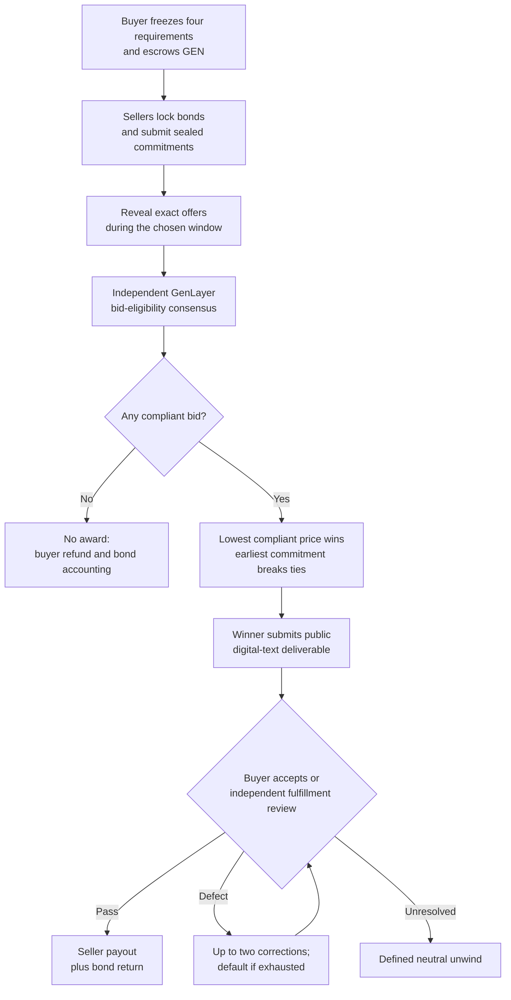

<p align="center">
  
</p>

<h1 align="center">ClauseBid</h1>

<p align="center"><strong>Where the lowest compliant bid wins.</strong></p>

<p align="center">
  An escrow-backed reverse-procurement marketplace on GenLayer.<br />
  Sellers compete on price. Independent AI consensus checks the terms. The contract controls the award and native GEN settlement.
</p>

<p align="center">
  <a href="https://clausebid.vercel.app"><strong>Live marketplace</strong></a>
  ·
  <a href="#how-it-works">How it works</a>
  ·
  <a href="#verified-on-studionet">Live evidence</a>
  ·
  <a href="#run-locally">Run locally</a>
</p>

<p align="center">
  <a href="https://github.com/ometere123/clausebid/actions/workflows/checks.yml"></a>
  
  
  
</p>

> **Development network:** ClauseBid is deployed on **GenLayer Studionet**, using development-network GEN. It is not a mainnet custody or production-money service. Every deliverable and bid reveal is public on-chain.

---

## The problem ClauseBid solves

The cheapest offer is not always the cheapest *compliant* offer.

A buyer might request product descriptions that include SEO titles and a six-month warranty. One seller bids 18 GEN but excludes SEO titles. Another bids 22 GEN but demands an extra charge for them. A third bids 25 GEN and includes everything. A price-only auction would select the wrong seller.

ClauseBid makes the buyer's requirements immutable, escrows the budget upfront, hides seller offers until reveal, and asks GenLayer validators to independently assess which bids actually satisfy **all four required clauses**. Only then does deterministic contract logic choose the lowest-priced compliant offer.

The same contract later reviews delivered work against those frozen obligations before payment is released or a correction/default path is applied.

### What makes it different

| Mechanism | Why it matters |
| --- | --- |
| **Funded procurement** | The buyer deposits the entire GEN budget before sellers take on the opportunity. |
| **Sealed commit–reveal** | Prices and offers are cryptographically committed before competitors can inspect them. |
| **Material AI consensus** | Independent validators check obligations, exclusions, contradictions and conditional charges, not just output formatting. |
| **Deterministic award** | The cheapest `COMPLIANT` bid wins; equal prices go to the earliest valid commitment. |
| **Delivery adjudication** | Buyer acceptance or independently validated fulfillment determines the seller's payment rights. |
| **Contract-enforced recovery** | Refunds, bond forfeitures, corrections and neutral unwinds follow recorded state, not administrator discretion. |
| **Public financial trail** | Procurement, seller, verdict, credit and immutable claim records can be inspected on-chain. |

## How it works



**For buyers:** create and fund a procurement, specify exactly four mandatory conditions, choose separate bidding windows, compare verified eligibility results, inspect delivery, and claim any refund or unused budget.

**For sellers:** read the immutable scope, post the required bond, save the secret reveal package, reveal the exact committed price and terms, and deliver the awarded work. Sellers recover their bonds when the rules permit; non-reveal or default can forfeit a bond.

**For participants and keepers:** initiate eligible reviews and deadline transitions without a privileged marketplace operator. The caller pays the relevant network transaction fees.

## Why GenLayer is essential

ClauseBid relies on **two economically consequential semantic decisions** made through GenLayer's Intelligent Contract execution and validator equivalence mechanism:

1. **Bid eligibility:** For each revealed offer, independently evaluate all four mandatory obligations. Missing work, excluded conditions, contradictory promises and mandatory upcharges can make a low bid ineligible.
2. **Delivery fulfillment:** Compare the delivered public text against the original requirements. A substantive pass enables seller settlement; a defect leads to correction or default; genuinely inconclusive results follow the contract's neutral-unwind rules.

Validators independently regenerate material clause-level findings and check the proposed decision. The contract, rather than the model, determines recipient addresses, winning prices, deadline arithmetic and GEN entitlements.

This is not an off-chain chatbot making a recommendation. **Semantic outcomes alter funded on-chain economic state.**

Independent evaluations can disagree, and a live `UNKNOWN` fulfillment verdict is not guaranteed. The contract preserves defined recovery and fail-closed behaviour instead of treating a disputed result as automatic approval. See [security and trust boundaries](docs/SECURITY.md).

## Buyer-configurable deadlines

Each buyer selects the commitment and reveal windows **independently** when funding a procurement. Both values and their derived deadlines become immutable for that procurement.

| Window | Minimum | Frontend default | Maximum |
| --- | ---: | ---: | ---: |
| Commitment | 10 minutes | 24 hours | 48 hours |
| Reveal | 20 minutes | 48 hours | 96 hours |
| **Total bidding** | **30 minutes** | **72 hours** | **144 hours** |

Different procurements can use different schedules **under the same deployed contract**. Short windows allow accelerated Studionet testing; longer windows are more practical when several sellers need time to participate.

From `T = commitment + reveal`, the contract derives immutable, bounded windows:

- **Eligibility review, seller delivery and review-grace periods:** `min(T, 72 hours)`
- **Buyer response:** `min(T / 3, 24 hours)`, using integer seconds
- **Each of two correction opportunities:** `min(2T / 3, 48 hours)`, using integer seconds

A timely reserved review remains protected while it is in flight, subject to the contract's explicit recovery rules. **Application deadlines do not shorten the network's consensus, appeal or finalization periods.** Very short bidding windows can expose participants to higher timing risk.

For exact transaction-boundary rules, see [the contract state machine](docs/STATE_MACHINE.md).

## Escrow and bond economics

| Rule | On-chain policy |
| --- | --- |
| Buyer budget | 5–100 native GEN, deposited in full |
| Mandatory requirements | Exactly four immutable clauses |
| Participating sellers | Up to 12 wallet addresses per procurement |
| Seller bond | 5% of budget, minimum 0.5 GEN, maximum 5 GEN |
| Offer price | From 1 GEN up to the funded budget |
| Protocol fee | No ClauseBid platform fee; network fees still apply |
| Award | Lowest finalized `COMPLIANT` offer |
| Valid losing reveals | Bond returned as claimable credit |
| Unrevealed bid | Bond forfeited according to contract rules |
| Successful fulfillment | Winning price and seller bond credited to the winner |
| Delivery default | Buyer recovery and winner-bond forfeiture |
| Inconclusive fulfillment | Contract-defined neutral unwind |

Credits are claimed by their intended wallets. A claim consumes its credit before emitting an outbound native-GEN value message, protecting against duplicate dispatch. Claims from multiple procurements may be aggregated for the same wallet.

## Seven connected screens

| Screen | What it does |
| --- | --- |
| **Home** | Explains ClauseBid and introduces live procurements. |
| **Marketplace** | Browse and filter funded procurements and their actual contract states. |
| **Create procurement** | Set the scope, four clauses, budget and independent commitment/reveal durations; fund from an injected wallet. |
| **Auction room** | Commit or reveal offers, inspect eligibility, advance reviews and finalize the award. |
| **Delivery workspace** | Submit work, accept or dispute delivery, initiate review, correct defects and recover expired cases. |
| **My dashboard** | Follow buyer/seller activity, wallet-specific credits and transaction status. |
| **Audit explorer** | Inspect contract state, eligibility findings, claim records and available transaction evidence. |

The frontend uses **injected EIP-1193 wallets** on Studionet. It has no database or backend authority. Reads are scoped to the active screen, concurrency is bounded, identical reads are deduplicated, and temporary RPC read failures can use limited retries and previously confirmed data. **Financial writes are never automatically resubmitted.**

## Verified on Studionet

The current **configurable-duration contract** has a recorded funded five-wallet demonstration and independent negative-path integration evidence. Historical transactions from older deployments are kept separately, never presented as proof of this contract's source.

### A real lowest-compliant-bid result

In funded **procurement #9**, four seller wallets competed for a 35 GEN budget:

| Offer | Eligibility | Award |
| --- | --- | --- |
| 18 GEN | `NONCOMPLIANT` | Excluded despite being cheapest |
| 22 GEN | `UNCERTAIN` after unresolved-review recovery | Ineligible |
| **25 GEN** | **`COMPLIANT`** | **Winner** |
| 28 GEN | `COMPLIANT` | Eligible but more expensive |

The award was followed by a submitted delivery and buyer acceptance; the procurement reached **`SETTLED`**.

- [Award transaction](https://explorer-studio.genlayer.com/tx/0xc2abf1df0cd2cca8c42c88b7a75bd4a47c10cecbdd7b977608c9dea1b752023d)
- [Delivery transaction](https://explorer-studio.genlayer.com/tx/0xde561ab49cc333ec5985138864ffb4f94c9e04afffe2e788215f60bc582b56ee)
- [Acceptance transaction](https://explorer-studio.genlayer.com/tx/0x3a1bb9991a265ae5db3cab035e9501028cfd6adc80a4c3704392add974c4d680)

### Verified engineering and financial evidence

- **Automated release checks:** 41 Direct Mode, 2 Python commitment-vector, 25 frontend-unit and 8 Playwright tests passed locally, alongside GenVM lint and the production build. The [latest verified release CI run](https://github.com/ometere123/clausebid/actions/runs/39181498318) and the [GitHub Actions release workflow](https://github.com/ometere123/clausebid/actions/workflows/checks.yml) are authoritative. Fixture-based Playwright tests are frontend regressions, **not** live wallet/consensus evidence.
- **Funded negative paths:** no-award refund, unrevealed-bond forfeiture, seller default, correction exhaustion, buyer refusal followed by independent fulfillment PASS, timely reserved-review protection, stale-review cancellation and duplicate/unauthorised claim rejection have archived transaction evidence.
- **Claim-accounting archive:** 19 immutable claims, **128 GEN dispatched**, **119 GEN outstanding** and **119 GEN contract balance**. Claim parents, beneficiaries and outbound message amounts are cross-checked in the archive.

The live attempt to obtain a semantic `UNKNOWN` fulfillment outcome did **not** produce that result after three finalized reviews. Direct Mode verifies the associated neutral-unwind branch; it is not represented as a completed live semantic-UNKNOWN demonstration.

**Settlement evidence boundary:** The stable Studionet SDK does not expose independent child-message acceptance for these claims. The recorded claim status remains `DISPATCHED_PENDING_EXTERNAL_SETTLEMENT`; parent finalization and beneficiary balance readbacks must not be presented as a separate proof of child acceptance.

**Explore the evidence:**
[Current evidence matrix](evidence/studionet/evidence-matrix.md) ·
[Funded demonstration](evidence/studionet/live-demo-configurable.json) ·
[Negative-path archives](evidence/README.md) ·
[Source verification](evidence/studionet/source-verification.json)

## Live contract and architecture

| Property | Value |
| --- | --- |
| Network | GenLayer Studionet |
| Chain ID | `61999` |
| RPC | `https://studio.genlayer.com/api` |
| Intelligent Contract | `0xD20Fc1C6b029c4FF4E2c64E8A8e2F6B91eCa161b` |
| Contract source | [`contracts/clausebid.py`](contracts/clausebid.py) |
| Deployment receipt | [View on explorer](https://explorer-studio.genlayer.com/tx/0x586ee807c33b94b58363ddff16d19f8141375a5309d0e5c5c78ed1a4c438be7c) |
| Source SHA-256 | `85939c9191661b34ec16a5d37a0d6ee1ad1ccb562ac066dec8b843c01879e241` |
| Production frontend | [clausebid.vercel.app](https://clausebid.vercel.app) |

The application has **one authoritative Python Intelligent Contract** and a **React 19 / TypeScript / Vite 7 / Tailwind CSS 4** static frontend on Vercel. Contract state is the source of truth; no centralized service allocates winners or payouts.

| Layer | Implementation |
| --- | --- |
| Intelligent Contract | Python 3.12, GenVM, custom substantive validator checking |
| Network tooling | Repository-local `genlayer@0.39.1`, `genlayer-js@1.1.8` |
| Frontend | React 19, TypeScript 5.9, Vite 7, Tailwind CSS 4 |
| Wallet | Browser-injected EIP-1193 |
| Tests | Direct Mode, pytest, Vitest, Playwright, CI |
| Deployment | Studionet contract and Vercel static frontend |

The source and fetched deployed code have a matching recorded SHA-256. Prior contract deployments retain their own evidence and liabilities; **funds and procurements are not migrated** to the new address.

## Run locally

**Requirements:** Node.js 22, Python 3.12, access to GenLayer Studionet, and an injected EIP-1193 wallet for signed transactions.

```bash
git clone https://github.com/ometere123/clausebid.git
cd clausebid

# Install the pinned repository-local GenLayer tooling
npm ci

# Install and run the frontend
npm ci --prefix frontend
cp frontend/.env.example frontend/.env

# Edit frontend/.env:
# VITE_CLAUSEBID_ADDRESS=0xD20Fc1C6b029c4FF4E2c64E8A8e2F6B91eCa161b
# VITE_STUDIONET_RPC=https://studio.genlayer.com/api

npm run dev
```

Vite prints the local URL (normally `http://localhost:5173`). Funding, bidding, reviews and claims use real Studionet transactions; wallet gas/consensus fees are separate from deposited GEN.

### Verify the code

```bash
# Python 3.12 virtual environment
python3.12 -m venv .venv
source .venv/bin/activate
python -m pip install --require-hashes -r requirements.lock

# Contract and Direct Mode
genvm-lint check contracts/clausebid.py
python -m pytest -q tests/test_commit_vectors.py
python -m pytest -q tests/direct

# Frontend
npm run build --prefix frontend
npm run test --prefix frontend
cd frontend
npx playwright install chromium
npm run test:e2e
```

On Windows PowerShell, create the environment using `py -3.12 -m venv .venv` and activate it with `.\.venv\Scripts\Activate.ps1`. The pinned GenVM runner cache may require the compatibility step documented in [.github/workflows/checks.yml](.github/workflows/checks.yml).

For deployment/source verification, funded multi-wallet scripts, resumable negative scenarios and reproducible evidence collection, see [the evidence guide](evidence/README.md) and the scripts in [`scripts/`](scripts/). **Never commit private keys, reveal salts, keystore passwords or local session files.**

## Repository guide

## Frontend read resilience

Read scheduling is screen-specific and uses one shared three-slot coordinator. Dashboard starts `get_credit(wallet)` before procurement discovery, then searches buyer and winner fields before bounded seller participation reads. Audit Explorer starts `get_economy()` independently from the selected procurement and retrieves claims in batches of three using the confirmed claim count. Marketplace and Home fetch procurement records only. Identical reads are deduplicated, queued work is scoped to the active page and wallet, and stale confirmed values are labelled rather than presented as fresh. The browser read timeout is 20 seconds, chosen as a bounded compromise after direct Studionet reads completed in roughly 1.3 to 2.1 seconds during the final read-only check and after comparison with SoulStamp's 45-second bound. Because the SDK does not cancel an underlying request, a timed-out read receives a one-second drain grace and the wrapper permits at most two unresolved SDK reads before failing fast with a recovery-limited diagnostic. Transient retries reset the pinned read client and honour numeric `Retry-After` data; timeouts, recovery limits, contract reverts, unsupported methods and generic JSON-RPC `-1` are classified separately and are not retried automatically. Financial writes are never retried.

When a read fails, the interface distinguishes a verified empty result, previously confirmed but potentially stale data, and unavailable data. It preserves confirmed balances and cards when an unrelated read fails, shows incomplete-result warnings until bounded searches finish, and records sanitized method, provider code, HTTP status, attempt count and last successful read time in deployment-scoped browser diagnostics. The test-only fixture harness is enabled only in Vite development builds and is never active in production.

```text
contracts/clausebid.py         Authoritative Intelligent Contract
frontend/src/                  Seven screens, wallet integration and reads
frontend/tests/e2e/            Browser regression tests
tests/direct/                  Contract state machine and time-boundary tests
scripts/                       Deployment checks and live scenario drivers
docs/STATE_MACHINE.md          Contract transitions and deadline rules
docs/SECURITY.md               Invariants, threats and trust boundaries
evidence/studionet/            Deployment provenance, receipts and results
.github/workflows/checks.yml  Continuous integration
```

## Security and limitations

ClauseBid provides **on-chain agreement about the published procurement rules**, not independent proof that a buyer's reference facts are true, that a delivery is original, or that public digital work has not already been copied.

- Bid terms and delivered text become **public** on-chain. Do not use the service for confidential material.
- A wallet is not a unique human identity. The bonded 12-wallet limit does not prevent Sybil participation.
- Independent semantic assessments can disagree or remain unresolved. The contract uses eligibility exclusions, review grace and documented unwind/default rules rather than assuming every model response is reliable.
- Native GEN escrow and claim entitlements have on-chain records, but child-message acceptance observability is limited on the current Studionet tooling. Ambiguous payouts are **never blindly retried**.
- StudioNet is a **development network**. This implementation is not a claim of commercial mainnet readiness or cryptographically guaranteed fair exchange of public text.

See [security and trust boundaries](docs/SECURITY.md), [the full state machine](docs/STATE_MACHINE.md) and [the evidence matrix](evidence/studionet/evidence-matrix.md).

### GenLayer references

[Storage](https://docs.genlayer.com/developers/intelligent-contracts/storage) ·
[Equivalence principle](https://docs.genlayer.com/developers/intelligent-contracts/equivalence-principle) ·
[Value transfers](https://docs.genlayer.com/developers/intelligent-contracts/features/value-transfers) ·
[Writing contract data](https://docs.genlayer.com/developers/decentralized-applications/writing-data) ·
[Direct Mode testing](https://docs.genlayer.com/developers/intelligent-contracts/testing)

---

<p align="center"><strong>ClauseBid</strong><br />Where the lowest compliant bid wins.</p>
